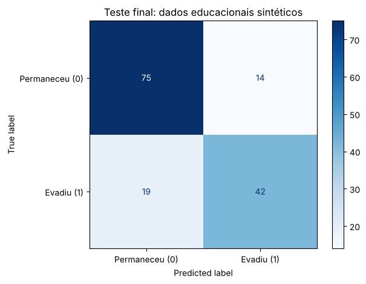
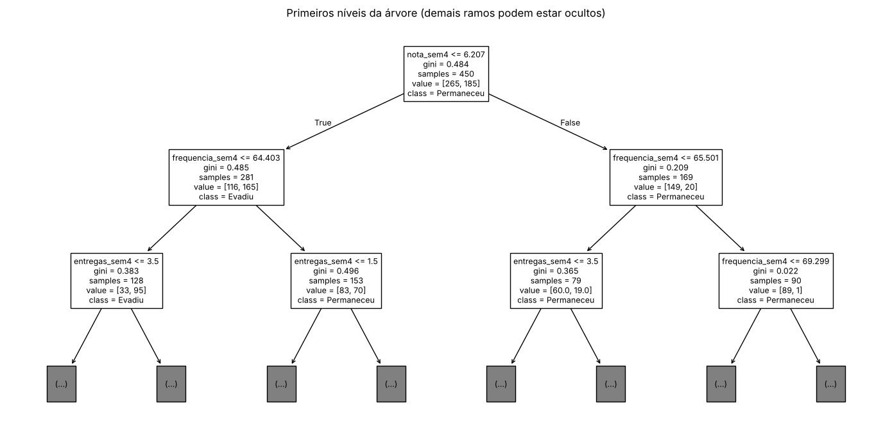
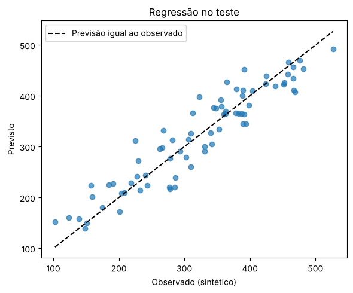
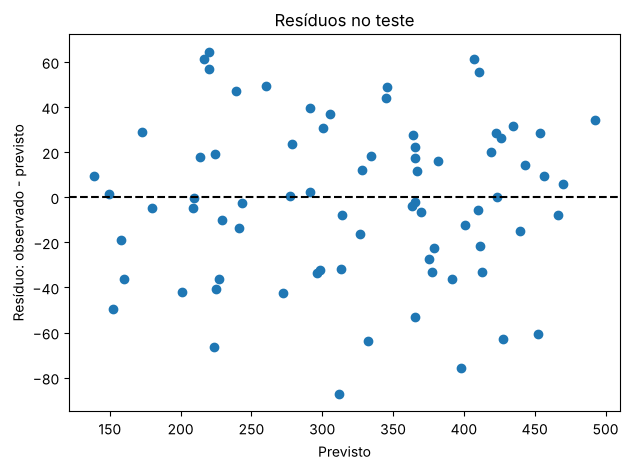

**Profa. Kadidja Valéria | UDF**  
Ciência de Dados e Aprendizado de Máquina · Sistemas de Informação · 2026.2

# Aula 2 — Registro do laboratório supervisionado

## Identificação

- Estudante ou equipe: Anna Beatriz Oki
- Turma: Ciência de Dados
- Data de realização: 28/10/2026
- Integrantes e contribuições (se em equipe): Atividade individual, realizada apenas por mim.

## Percurso escolhido

- [x] Python/Colab ou Jupyter.
- [ ] Orange Data Mining.

Use o [notebook de apoio](notebooks/laboratorio.ipynb) ou o [CSV sintético](dados/educacionais-sinteticos.csv). O CSV contém 600 registros fictícios. Atributos: `frequencia_sem4`, `nota_sem4`, `entregas_sem4`. Alvo: `evasao_fim_semestre` (0 permaneceu, 1 evadiu). As associações foram definidas pela simulação, sem validade empírica sobre estudantes reais.

## 1. Ambiente e reprodução

| Item | Registro |
| --- | --- |
| Ambiente e data | Jupyter (Python 3.13.16), executado em 28/10/2026 |
| Versões das ferramentas/bibliotecas | NumPy 2.5.3, pandas 3.0.5, matplotlib 3.11.2, scikit-learn 1.9.1 |
| Semente aleatória | 42 |
| Caminho do notebook executado ou fluxo Orange | [notebooks/laboratorio-equipe.ipynb](notebooks/laboratorio-equipe.ipynb) |
| Origem dos dados e condição sintética | CSV da disciplina (`dados/educacionais-sinteticos.csv`), com 600 registros fictícios gerados por simulação. Não são estudantes reais. |

## 2. Problema e preparação

- Pergunta de negócio: Quem poderia receber um convite voluntário de apoio antes do fim do semestre?
- Unidade de análise e horizonte: Um estudante fictício. A previsão é feita na semana 4 do semestre.
- Atributos disponíveis no instante da previsão: `frequencia_sem4`, `nota_sem4` e `entregas_sem4`, observados até a semana 4.
- Variável-alvo e sua natureza: `evasao_fim_semestre`, categórica com duas classes (0 permaneceu, 1 evadiu). No conjunto, 59% permaneceram e 41% evadiram.
- Ausências e outros problemas encontrados: 30 valores ausentes em `nota_sem4`. As outras colunas estão completas. As classes são um pouco desbalanceadas (59% e 41%).
- Tratamentos e conjunto usado para aprendê-los: Os valores ausentes foram preenchidos com a mediana de cada coluna. A mediana é aprendida só no conjunto de treino, dentro do `Pipeline`, para o teste não influenciar.

## 3. Desenvolvimento e teste

- Método de divisão e justificativa: Divisão aleatória com 25% para teste e `stratify=y`, que mantém a proporção das classes. É adequada porque os registros são independentes. Para prever turmas novas, o ideal seria separar por período.
- Quantidades de treino e teste: 450 registros de treino e 150 de teste.
- Procedimento de validação no treino: Validação cruzada estratificada com 5 partes, feita só no treino.
- Parâmetros da árvore e como foram escolhidos: `max_depth` testado em 2, 3, 5 e sem limite, e escolhido 5 por ter a maior acurácia média de validação (0,7222). `min_samples_leaf` = 10, valor padrão do notebook, comparado depois com 5, 20 e 40 (seção 5).
- Como o teste ficou fora da seleção: A profundidade e os experimentos usaram só o treino, com validação cruzada. O teste foi usado uma única vez, no final, para a avaliação.

### Alternativa Orange

Confira o alvo como categórico. Registre as conexões: File/Select Columns → Test & Score (Data), Tree → Test & Score (Learner), Test & Score → Confusion Matrix (Evaluation Results). Data Table permite inspeção. Se usar Preprocess, conecte o preprocessor ao learner para ajustar transformações dentro do treino. Não use apenas `Test on train data` como avaliação final.

**Fluxo e método de avaliação realmente utilizados:** Não usei Orange. Usei Python no notebook, com divisão treino/teste e validação cruzada de 5 partes no treino.

Se comparar configurações, use validação no treino e reserve teste independente. Documente em Test & Score as entradas Data e Test Data, quando utilizadas.

## 4. Resultados calculados de classificação

| Modelo | Configuração | Acurácia de treino | Acurácia de validação e dispersão | Acurácia de teste |
| --- | --- | --- | --- | --- |
| Referência | Sempre prevê a classe mais frequente ("permaneceu") | 0,5889 | 0,5889 ± 0,0000 | 0,5933 |
| Árvore final | Profundidade 5, folha mínima 10, mediana nas ausências | 0,8133 | 0,7222 ± 0,0391 | 0,7800 |

Não invente valores. Se sua ferramenta não produziu uma medida, registre “não calculada” e explique.

**Matriz: linhas reais e colunas previstas; classe positiva = 1.**

| Real / previsto | Permaneceu (0) | Evadiu (1) |
| --- | --- | --- |
| Permaneceu (0) | 75 (TN) | 14 (FP) |
| Evadiu (1) | 19 (FN) | 42 (TP) |

- Acurácia calculada manualmente pela matriz: (75 + 42) ÷ 150 = 117 ÷ 150 = **0,78**
- Sensibilidade da classe 1: 42 ÷ (42 + 19) = 42 ÷ 61 ≈ **0,69**
- Comparação com referência: A árvore acertou 78% no teste, contra 59,3% da referência, cerca de 19 pontos percentuais a mais.
- Consequências dos falsos positivos: Foram 14 estudantes que não iam evadir e receberiam o convite de apoio sem precisar. É um contato desnecessário, mas de baixo custo, porque o apoio é voluntário.
- Consequências dos falsos negativos: Foram 19 estudantes que evadiram e não receberiam o convite. É o erro mais grave aqui, porque eles perdem a chance de apoio.
- Interpretação do gráfico e da árvore: A matriz mostra mais acertos nas duas classes, mas o modelo deixa passar cerca de 31% de quem evadiu (19 de 61). A árvore começa dividindo pela nota (nota ≤ 6,21) e depois usa frequência e entregas. A nota teve a maior importância (0,62).

## 5. Experimentos no treino

Compare parâmetros usando apenas treino/validação. Após conhecer o teste, uma nova seleção exige novo teste independente para avaliação final.

| Experimento | Alteração | Resultado de validação | Interpretação |
| --- | --- | --- | --- |
| 1 | Folha mínima 5, 10, 20 e 40 (profundidade 5) | 0,7222 ± 0,0298 / 0,7222 ± 0,0391 / 0,7267 ± 0,0480 / 0,7289 ± 0,0303 | As diferenças são pequenas perto da dispersão, então não dá pra dizer que uma é melhor. Com folhas maiores, a acurácia de treino cai (0,8261 para 0,7756), ou seja, o modelo fica mais simples. |
| 2 | Retirar um atributo (sem frequência / sem nota / sem entregas) | 0,7156 / 0,6289 / 0,7022 | Tirar a nota foi o que mais piorou a validação. Isso mostra que ela ajuda a prever, mas não prova que causa a evasão. |

Responda:

1. Como a profundidade e o tamanho das folhas podem afetar o sobreajuste? Uma árvore muito funda, com folhas pequenas, acaba "decorando" o treino. Sem limite de profundidade, a acurácia no treino foi 0,8206 e na validação só 0,7111. Folhas maiores deixam o modelo mais simples, e a validação quase não mudou.
2. Retirar um atributo e observar mudança no desempenho prova causalidade? Não. Só mostra que o atributo ajuda a prever neste conjunto. As relações foram definidas pela simulação, e em dados reais outros fatores poderiam influenciar.
3. Se 95% permanecem, o que acontece com um modelo que sempre prevê permanência? Ele acertaria 95%, mas nunca identificaria quem vai evadir (sensibilidade zero). A acurácia pareceria ótima e o modelo seria inútil. Na matriz, o TP seria 0.

## 6. Regressão — seção independente

Execute a seção da biblioteca no notebook ou registre o procedimento equivalente em Orange. Dados também sintéticos. Alvo numérico: empréstimos por semana.

| Item | Registro |
| --- | --- |
| Atributos e alvo | Atributos: `usuarios_ativos` e `horas_abertura`. Alvo: `emprestimos_semana` (número). 300 registros sintéticos. |
| Divisão e preparação | Divisão aleatória com 25% para teste (225 de treino e 75 de teste), semente 42. Mediana nas ausências e regressão linear. |
| MAE do modelo e unidade | 28,59 empréstimos por semana |
| MAE da referência | 84,73 empréstimos por semana (prever sempre a média) |
| R² do teste | 0,8774 |
| Interpretação do gráfico observado/previsto | Os pontos ficam perto da linha tracejada, então as previsões acompanham os valores reais. Há um pouco de superestimação nos valores mais baixos. |
| Interpretação dos resíduos | Ficam espalhados em volta de zero, sem padrão claro. Os maiores erros chegam a cerca de 60 a 85 empréstimos. |
| Limitação de extrapolação | O modelo viu de 100 a 1000 usuários. Prever para 10.000 está muito fora do que ele conheceu, e a reta pode não valer ali. |

Explique por que R² não é porcentagem de acertos: O R² compara os erros do modelo com os de sempre prever a média. Um R² de 0,88 significa que o modelo reduziu bastante o erro em relação à média, e não que acertou 88% dos casos.

## 7. Evidências e conclusão

- Link relativo do notebook/fluxo: [notebooks/laboratorio-equipe.ipynb](notebooks/laboratorio-equipe.ipynb)
- Links das imagens, se houver: [matriz-confusao.png](assets/matriz-confusao.png), [arvore-decisao.png](assets/arvore-decisao.png), [regressao-observado-previsto.png](assets/regressao-observado-previsto.png) e [regressao-residuos.png](assets/regressao-residuos.png)
- Principal aprendizado: A acurácia sozinha engana. É preciso comparar com uma referência, olhar os tipos de erro e escolher os parâmetros só com o treino.
- Limitações de generalização e vieses possíveis: Os dados são sintéticos, as relações foram definidas pela simulação e há só uma divisão de teste (150 casos). Não há grupos reais, então não dá pra falar de equidade.
- Cuidados com privacidade e uso responsável: Usei só dados sintéticos, sem nomes nem matrículas. Em um caso real: acesso restrito, apoio voluntário, revisão por pessoas e direito de contestar.

Para inserir uma imagem salva, use `` e confira se o arquivo existe. Mostre apenas dados sintéticos.

[Voltar ao início](README.md).
